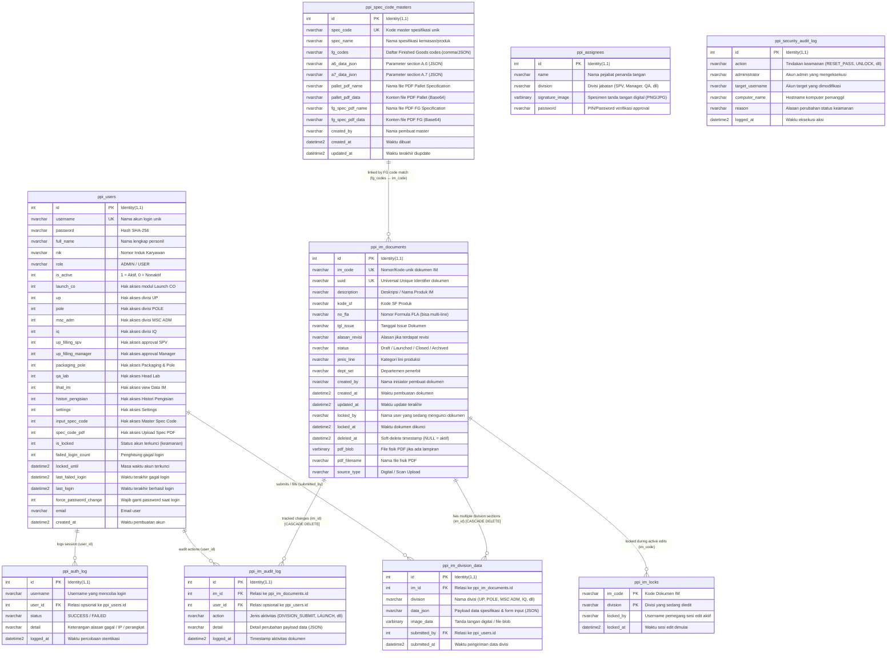

# DOKUMENTASI ERD & ARSITEKTUR DATABASE SISTEM IM DIGITAL

Dokumen ini disusun sebagai panduan teknis resmi bagi **Tim IT / Infrastructure / Database Administrator** untuk keperluan deployment, hosting, dan integrasi database sistem **Instruksi Mutu (IM) Digital**.

> **Versi Dokumen**: 2.2 — Terakhir diperbarui: 21 Oktober 2026

---

## 1. SPESIFIKASI DATABASE

| Parameter | Spesifikasi | Keterangan |
| :--- | :--- | :--- |
| **RDBMS Target** | Microsoft SQL Server 2016 / 2019 / 2022 / Azure SQL Database | Kompatibel penuh dengan T-SQL & Dapper ORM |
| **Nama Database Default** | `IM_Database` | Dapat disesuaikan di `appsettings.json` |
| **Collation Rekomendasi**| `SQL_Latin1_General_CP1_CI_AS` | Case-Insensitive, Accent-Sensitive |
| **Koneksi / Pooling** | Min: 1, Max: 50 connection | Dikelola otomatis oleh `DbConnectionFactory` |
| **Keamanan Kredensial** | Mendukung Windows Integrated Security atau SQL Authentication | Konfigurasi fleksibel |
| **Mekanisme Migrasi** | Automatic Schema Initialization (`DbInitializer.cs`) | Otomatis membuat tabel & indeks saat API backend pertama kali start |

---

## 2. ENTITY RELATIONSHIP DIAGRAM (ERD)

Diagram berikut memetakan 9 entitas/tabel utama dan hubungan kardinalitas antar tabel di dalam sistem:



---

## 3. KAMUS DATA (DATA DICTIONARY) LENGKAP

### 3.1. Tabel `ppi_users` (Manajemen Pengguna & Otoritas)
Menyimpan kredensial pengguna, profil, dan matriks hak akses 14 divisi/fitur secara granular.

| Kolom | Tipe Data | Nullable | Default | Keterangan & Constraint |
| :--- | :--- | :---: | :---: | :--- |
| `id` | `INT` | No | `IDENTITY(1,1)` | **PRIMARY KEY**. ID unik user |
| `username` | `NVARCHAR(100)` | No | - | **UNIQUE**. Username login |
| `password` | `NVARCHAR(64)` | No | - | Hash SHA-256 dari password user |
| `full_name` | `NVARCHAR(200)` | No | `''` | Nama lengkap karyawan |
| `nik` | `NVARCHAR(50)` | No | `''` | Nomor Induk Karyawan |
| `role` | `NVARCHAR(20)` | No | `'USER'` | Hak role: `'ADMIN'` atau `'USER'` |
| `is_active` | `INT` | No | `1` | `1` = Aktif, `0` = Dinonaktifkan |
| `created_at` | `DATETIME2` | No | `GETDATE()` | Waktu pendaftaran user |
| `launch_co` | `INT` | No | `0` | Hak akses inisiasi dokumen Launch CO |
| `up` | `INT` | No | `0` | Hak akses input data Unit Pengolahan (UP) |
| `pole` | `INT` | No | `0` | Hak akses input data POLE |
| `msc_adm` | `INT` | No | `0` | Hak akses divisi MSC ADM |
| `iq` | `INT` | No | `0` | Hak akses divisi IQ (Inspection & Quality) |
| `up_filling_spv` | `INT` | No | `0` | Hak akses review & sign SPV Filling |
| `up_filling_manager` | `INT` | No | `0` | Hak akses review & sign Manager Filling |
| `packaging_pole` | `INT` | No | `0` | Hak akses review & sign Packaging & Pole |
| `qa_lab` | `INT` | No | `0` | Hak akses review & sign Head Lab |
| `lihat_im` | `INT` | No | `0` | Hak akses mode baca (Data IM) bagi operator |
| `histori_pengisian` | `INT` | No | `0` | Hak akses melihat audit trail histori |
| `settings` | `INT` | No | `0` | Hak akses modul konfigurasi sistem |
| `input_spec_code` | `INT` | No | `0` | Hak akses master data Spec Code |
| `spec_code_pdf` | `INT` | No | `0` | Hak akses upload lampiran PDF Spec Code |
| `is_locked` | `INT` | No | `0` | `1` jika akun terkunci karena proteksi brute-force |
| `failed_login_count` | `INT` | No | `0` | Counter salah password beruntun |
| `locked_until` | `DATETIME2` | Yes | `NULL` | Masa kedaluwarsa lock otomatis |
| `last_failed_login`| `DATETIME2` | Yes | `NULL` | Timestamp kegagalan login terakhir |
| `last_login` | `DATETIME2` | Yes | `NULL` | Timestamp login sukses terakhir |
| `force_password_change` | `INT` | No | `0` | `1` jika user wajib ubah password saat login |
| `email` | `NVARCHAR(200)` | Yes | `NULL` | Alamat email korporat |
| `created_by` | `NVARCHAR(100)` | Yes | `NULL` | Administrator yang mendaftarkan akun |
| `last_modified_by` | `NVARCHAR(100)` | Yes | `NULL` | Administrator pengubah terakhir |
| `last_modified_date` | `DATETIME2` | Yes | `NULL` | Timestamp modifikasi terakhir |

> **Catatan Kolom Legacy**: Kolom `up_head_manager` dan `password_plain` mungkin ada di database lama/yang telah di-seed secara manual (terdapat di skrip SQL lama), namun **tidak digunakan oleh backend .NET aktif**. Kolom-kolom ini boleh dipertahankan di database untuk backward-compatibility tetapi tidak perlu di-provisioning untuk deployment baru.

---

### 3.2. Tabel `ppi_im_documents` (Header Dokumen Instruksi Mutu)
Menyimpan entitas inti seluruh dokumen Instruksi Mutu yang diterbitkan.

| Kolom | Tipe Data | Nullable | Default | Keterangan & Constraint |
| :--- | :--- | :---: | :---: | :--- |
| `id` | `INT` | No | `IDENTITY(1,1)` | **PRIMARY KEY**. ID unik dokumen IM |
| `im_code` | `NVARCHAR(50)` | No | - | Kode unik dokumen IM (misal: `IM-2026-001`). Memiliki filtered unique index non-clustered `WHERE deleted_at IS NULL` |
| `uuid` | `NVARCHAR(50)` | Yes | `NULL` | **UNIQUE**. Kode UUID untuk integrasi barcode/QR |
| `description` | `NVARCHAR(1000)` | Yes | `NULL` | Deskripsi / Nama formula produk |
| `kode_sf` | `NVARCHAR(50)` | Yes | `NULL` | Kode Semi Finished (SF) |
| `no_fla` | `NVARCHAR(MAX)` | Yes | `NULL` | Nomor Formula Laboratorium (mendukung multi-FLA) |
| `tgl_issue` | `NVARCHAR(20)` | Yes | `NULL` | Tanggal terbit instruksi mutu |
| `alasan_revisi`| `NVARCHAR(1000)` | Yes | `NULL` | Catatan alasan revisi dokumen |
| `status` | `NVARCHAR(20)` | No | `'Draft'` | Status siklus: `'Draft'`, `'Launched'`, `'Closed'`, `'Deleted'` |
| `jenis_line` | `NVARCHAR(100)` | Yes | `NULL` | Kategori Lini (Bottle Line, Tube Line, Sachet Line, dll.) |
| `dept_set` | `NVARCHAR(100)` | Yes | `NULL` | Departemen penerbit dokumen |
| `created_by` | `NVARCHAR(100)` | Yes | `NULL` | User pembuat dokumen di Launch CO |
| `created_at` | `DATETIME2` | No | `GETDATE()` | Waktu pembuatan dokumen |
| `updated_at` | `DATETIME2` | No | `GETDATE()` | Waktu update metadata terakhir |
| `locked_by` | `NVARCHAR(100)` | Yes | `NULL` | User yang sedang mengunci status dokumen |
| `locked_at` | `DATETIME2` | Yes | `NULL` | Waktu dokumen dikunci |
| `deleted_at` | `DATETIME2` | Yes | `NULL` | Soft-deletion timestamp (`NULL` = Dokumen Aktif) |
| `pdf_blob` | `VARBINARY(MAX)` | Yes | `NULL` | Konten biner jika dokumen diunggah dalam format PDF fisik |
| `pdf_filename` | `NVARCHAR(500)` | Yes | `NULL` | Nama file PDF fisik |
| `source_type` | `NVARCHAR(20)` | No | `'Digital'` | `'Digital'` (form web) atau `'Scan'` (arsip PDF manual) |

---

### 3.3. Tabel `ppi_im_division_data` (Detail Pengisian Data per Divisi)
Menyimpan payload data spesifik tiap bagian divisi untuk setiap dokumen IM.

| Kolom | Tipe Data | Nullable | Default | Keterangan & Constraint |
| :--- | :--- | :---: | :---: | :--- |
| `id` | `INT` | No | `IDENTITY(1,1)` | **PRIMARY KEY**. ID unik baris data divisi |
| `im_id` | `INT` | No | - | **FOREIGN KEY** &rarr; `ppi_im_documents(id)` dengan opsi `ON DELETE CASCADE` |
| `division` | `NVARCHAR(50)` | No | - | Nama divisi: `'UP'`, `'POLE'`, `'MSC ADM'`, `'IQ'`, `'UP FILLING SPV'`, `'UP FILLING MANAGER'`, `'PACKAGING & POLE'`, `'HEAD LAB'`, `'A.3. Appearance Packing (MSC)'`, `'Signatures'` |
| `data_json` | `NVARCHAR(MAX)` | Yes | `NULL` | Struktur JSON fleksibel berisi form input, nomor nozzel, setting QC, toleransi, dan catatan |
| `image_data` | `VARBINARY(MAX)` | Yes | `NULL` | Biner gambar tanda tangan digital atau snapshot kanvas visual |
| `submitted_by`| `INT` | Yes | `NULL` | **FOREIGN KEY** &rarr; `ppi_users(id)` personil yang mengirim data |
| `submitted_at`| `DATETIME2` | No | `GETDATE()` | Waktu pengisian/tanda tangan data divisi |

> **Constraint Khusus**: `CONSTRAINT UQ_ppi_im_division UNIQUE(im_id, division)` menjamin satu dokumen IM hanya memiliki satu catatan aktif per divisi.

> **Nilai Division yang Digunakan Aktif oleh Backend:**
> | Nilai `division` | Keterangan |
> | :--- | :--- |
> | `UP` | Data input Unit Pengolahan (Line, QC Filling, Nozzle) |
> | `POLE` | Data input POLE (A.1 Filling, A.2 Assembly, A.3 Packing, A.6 Paletisasi, A.7 Vaccum/Jacomex) |
> | `MSC ADM` | Data input MSC ADM (A.3 Appearance Packing MSC) |
> | `A.3. Appearance Packing (MSC)` | Alternatif nama divisi MSC ADM (legacy, tetap didukung) |
> | `IQ` | Data input IQ (Batch Number, Quality Surveillance) |
> | `UP FILLING SPV` | Tanda tangan approval Supervisor Filling |
> | `UP FILLING MANAGER` | Tanda tangan approval Manager Filling |
> | `PACKAGING & POLE` | Tanda tangan approval Packaging & Pole |
> | `HEAD LAB` | Tanda tangan final approval Head Lab |
> | `Signatures` | Data legacy tanda tangan gabungan (comment, timestamp, names) |

---

### 3.4. Tabel `ppi_im_locks` (Concurrency & Session Edit Locking)
Mencegah *race condition* (tabrakan saat dua user mengedit form divisi yang sama secara bersamaan).

| Kolom | Tipe Data | Nullable | Default | Keterangan & Constraint |
| :--- | :--- | :---: | :---: | :--- |
| `im_code` | `NVARCHAR(50)` | No | - | **COMPOSITE PRIMARY KEY** (bagian 1). Kode dokumen IM |
| `division` | `NVARCHAR(50)` | No | - | **COMPOSITE PRIMARY KEY** (bagian 2). Nama divisi yang sedang dibuka |
| `locked_by` | `NVARCHAR(100)` | Yes | `NULL` | Username yang sedang aktif mengedit |
| `locked_at` | `DATETIME2` | No | `GETDATE()` | Waktu kunci sesi diaktifkan |

---

### 3.5. Tabel `ppi_spec_code_masters` (Master Spesifikasi Produk & PDF)
Menyimpan katalog master spesifikasi kemasan, finished goods, gambar pole, dan dokumen PDF teknis. Data A.6 dan A.7 dari tabel ini digunakan secara otomatis saat dokumen IM dibuka berdasarkan kecocokan kode FG (`fg_codes` ↔ `im_code`).

| Kolom | Tipe Data | Nullable | Default | Keterangan & Constraint |
| :--- | :--- | :---: | :---: | :--- |
| `id` | `INT` | No | `IDENTITY(1,1)` | **PRIMARY KEY**. ID unik spesifikasi |
| `spec_code` | `NVARCHAR(100)` | No | - | **UNIQUE**. Kode unik Master Spec |
| `spec_name` | `NVARCHAR(200)` | Yes | `NULL` | Nama dagang / deskripsi spesifikasi |
| `fg_codes` | `NVARCHAR(MAX)` | Yes | `NULL` | Daftar kode Finished Goods (FG) terikat (CSV, dipisahkan koma/semicolon/newline) |
| `a6_data_json` | `NVARCHAR(MAX)` | Yes | `NULL` | Parameter teknis dan geometri Bagian A.6 Paletisasi dalam format JSON |
| `a7_data_json` | `NVARCHAR(MAX)` | Yes | `NULL` | Parameter teknis Bagian A.7 Vaccum/Jacomex dalam format JSON |
| `pallet_pdf_name` | `NVARCHAR(255)` | Yes | `NULL` | Nama berkas PDF petunjuk susunan Pallet |
| `pallet_pdf_data` | `NVARCHAR(MAX)` | Yes | `NULL` | Payload Base64 dokumen PDF Pallet |
| `fg_spec_pdf_name`| `NVARCHAR(255)` | Yes | `NULL` | Nama berkas PDF Finished Goods Specification |
| `fg_spec_pdf_data`| `NVARCHAR(MAX)` | Yes | `NULL` | Payload Base64 dokumen PDF FG Specification |
| `created_by` | `NVARCHAR(100)` | Yes | `NULL` | Nama user pembuat master |
| `created_at` | `DATETIME2` | No | `GETDATE()` | Waktu pembuatan master |
| `updated_at` | `DATETIME2` | No | `GETDATE()` | Waktu modifikasi terakhir |

---

### 3.6. Tabel `ppi_assignees` (Master Penanda Tangan & Pejabat Berwenang)
Menyimpan profil pejabat yang berwenang memberikan tanda tangan digital/approval pada dokumen IM.

> **Catatan**: Tabel ini merupakan tabel **legacy** dari versi WPF. Pada versi Web App aktif, proses tanda tangan digital telah dimigrasi ke mekanisme verifikasi via `ppi_users` + API `/api/auth/login`. Tabel ini tetap dipertahankan untuk backward-compatibility.

| Kolom | Tipe Data | Nullable | Default | Keterangan & Constraint |
| :--- | :--- | :---: | :---: | :--- |
| `id` | `INT` | No | `IDENTITY(1,1)` | **PRIMARY KEY**. ID unik pejabat |
| `name` | `NVARCHAR(200)` | No | - | Nama lengkap pejabat penanda tangan |
| `division` | `NVARCHAR(100)` | No | - | Jabatan/Divisi (UP SPV, Filling Manager, QA Head, dll.) |
| `signature_image` | `VARBINARY(MAX)` | Yes | `NULL` | Gambar spesimen tanda tangan |
| `password` | `NVARCHAR(100)` | Yes | `NULL` | PIN / Kredensial verifikasi sebelum tanda tangan dibubuhkan |

---

### 3.7. Tabel `ppi_auth_log` (Audit Trail Otentikasi)
Mencatat seluruh rekam jejak aktivitas login (sukses maupun gagal) untuk kepatuhan audit keamanan IT.

| Kolom | Tipe Data | Nullable | Default | Keterangan & Constraint |
| :--- | :--- | :---: | :---: | :--- |
| `id` | `INT` | No | `IDENTITY(1,1)` | **PRIMARY KEY**. ID unik log |
| `username` | `NVARCHAR(200)` | Yes | `NULL` | Username yang diinput saat login |
| `user_id` | `INT` | Yes | `NULL` | **FOREIGN KEY** &rarr; `ppi_users(id)` (jika user terdaftar) |
| `status` | `NVARCHAR(50)` | Yes | `NULL` | `'SUCCESS'` atau `'FAILED'` |
| `detail` | `NVARCHAR(500)` | Yes | `NULL` | Keterangan pesan error / perangkat pemanggil |
| `logged_at` | `DATETIME2` | No | `GETDATE()` | Timestamp sesi login |

---

### 3.8. Tabel `ppi_security_audit_log` (Audit Trail Modifikasi Keamanan)
Mencatat aktivitas administrator terkait manajemen akun (unlock user, reset password, dll.).

| Kolom | Tipe Data | Nullable | Default | Keterangan & Constraint |
| :--- | :--- | :---: | :---: | :--- |
| `id` | `INT` | No | `IDENTITY(1,1)` | **PRIMARY KEY**. ID unik audit log |
| `action` | `NVARCHAR(100)` | Yes | `NULL` | Jenis tindakan (contoh: `'RESET_PASSWORD'`, `'UNLOCK_USER'`) |
| `administrator` | `NVARCHAR(100)` | Yes | `NULL` | Akun admin yang melakukan tindakan |
| `target_username`| `NVARCHAR(100)` | Yes | `NULL` | Akun user yang menjadi objek modifikasi |
| `computer_name` | `NVARCHAR(100)` | Yes | `NULL` | Hostname / IP komputer pemanggil |
| `reason` | `NVARCHAR(500)` | Yes | `NULL` | Alasan justifikasi perubahan |
| `logged_at` | `DATETIME2` | No | `GETDATE()` | Timestamp eksekusi |

---

### 3.9. Tabel `ppi_im_audit_log` (Audit Trail Modifikasi Dokumen IM)
Mencatat seluruh rekam jejak perubahan data pada dokumen Instruksi Mutu (create, update, delete, approval, revisi, dsb.) untuk keperluan traceability.

> **Catatan**: Tabel ini tersedia di skema database (dibuat oleh SQL script deployment), namun **belum digunakan secara aktif oleh backend .NET**. Tabel ini disiapkan untuk kebutuhan audit trail dokumen IM di masa depan. Data audit saat ini masih dikelola via `ppi_auth_log` dan `ppi_security_audit_log`.

| Kolom | Tipe Data | Nullable | Default | Keterangan & Constraint |
| :--- | :--- | :---: | :---: | :--- |
| `id` | `INT` | No | `IDENTITY(1,1)` | **PRIMARY KEY**. ID unik audit log |
| `im_id` | `INT` | Yes | `NULL` | **FOREIGN KEY** &rarr; `ppi_im_documents(id)` ON DELETE CASCADE. Dokumen IM terkait |
| `user_id` | `INT` | Yes | `NULL` | **FOREIGN KEY** &rarr; `ppi_users(id)`. User yang melakukan aksi |
| `action` | `NVARCHAR(100)` | Yes | `NULL` | Jenis aksi (contoh: `'CREATE'`, `'UPDATE'`, `'DELETE'`, `'APPROVE'`, `'REVISE'`) |
| `detail` | `NVARCHAR(MAX)` | Yes | `NULL` | Detail perubahan atau keterangan tambahan |
| `logged_at` | `DATETIME2` | No | `GETDATE()` | Timestamp eksekusi aksi |

---

## 4. T-SQL SCRIPT LENGKAP (UNTUK PEMBUATAN DATABASE MANUAL)

Jika Tim IT menghendaki script DDL resmi untuk mengeksekusi pembuatan skema database secara manual di SSMS, silakan gunakan file terpisah: **`SKEMA_DATABASE_IM_DIGITAL.sql`**

Script tersebut mencakup:
1. Pembuatan database `IM_Database`
2. Pembuatan 9 tabel dengan seluruh constraint, foreign key, dan index
3. Seed akun administrator default (password: `admin`, hash SHA-256)

---

## 5. ALUR WORKFLOW DIVISI & STATUS DOKUMEN IM

Berikut adalah alur workflow pengisian dokumen IM Digital:

```
LAUNCH CO → UP → POLE → MSC ADM → IQ → UP FILLING SPV → UP FILLING MANAGER → PACKAGING & POLE → HEAD LAB → DATA IM (Selesai)
```

| Tahap | Divisi | Prasyarat Terlihat | Jenis Data |
| :---: | :--- | :--- | :--- |
| 1 | **LAUNCH CO** | - | Membuat dokumen IM baru (header) |
| 2 | **UP** | Dokumen status `Launched` | Input Line, QC Filling, Nozzle |
| 3 | **POLE** | Dokumen status `Launched` | Input A.1, A.2, A.3 (POLE), A.6, A.7 |
| 4 | **MSC ADM** | Dokumen status `Launched` | Input A.3 Appearance Packing (MSC) |
| 5 | **IQ** | Dokumen status `Launched` | Input Batch Number, Quality Surveillance |
| 6 | **UP FILLING SPV** | UP sudah diisi | Tanda tangan approval Supervisor |
| 7 | **UP FILLING MANAGER** | UP FILLING SPV sudah sign | Tanda tangan approval Manager |
| 8 | **PACKAGING & POLE** | POLE sudah diisi | Tanda tangan approval Packaging |
| 9 | **HEAD LAB** | Semua divisi (2–8) sudah selesai | Tanda tangan final Head Lab |

> Setelah HEAD LAB menandatangani, dokumen berpindah ke **DATA IM** (dokumen selesai/closed) dan tidak lagi muncul di daftar divisi aktif.

---

## 6. REKOMENDASI DEPLOYMENT & HOSTING BAGI TIM IT

1. **Panduan Praktis & Quick-Start**:
   * Untuk panduan langkah-demi-langkah deployment cepat dan konfigurasi firewall, silakan rujuk berkas: **`PANDUAN_HOSTING.md`**.
   * Sistem telah dilengkapi script otomatisasi satu-klik:
     * `JALANKAN_PRODUCTION.bat`: Mem-build dan menjalankan service produksi dengan binding `0.0.0.0` (dapat diakses seluruh LAN).
     * `HENTIKAN_WEB.bat`: Mematikan seluruh proses backend dan frontend dengan aman.

2. **Arsitektur Jaringan & Dynamic Proxy**:
   * **Frontend Web (Next.js)**: Berjalan di port `3000`. Menggunakan *Dynamic Host Detection* dan reverse proxy rewrite (`/api/*` dialihkan langsung ke port `5268` di localhost server). Klien dari laptop/HP lain cukup mengakses `http://[IP-Server]:3000`.
   * **Backend API (.NET 8)**: Berjalan di port `5268` dengan policy CORS terbuka untuk Next.js.
   * **Port Firewall**: Cukup izinkan inbound TCP port `3000` (dan `5268` jika ada integrasi aplikasi eksternal).

3. **Konfigurasi Connection String**:
   * Tim IT cukup mengedit konfigurasi database di file `dotnet/PPI.IM.WebApi/appsettings.json` atau `appsettings.Production.json`:
     ```json
     {
       "Database": {
         "Server": "IP_ATAU_HOSTNAME_SQL_SERVER",
         "Database": "IM_Database",
         "TrustedConnection": false,
         "Username": "sa_im_digital",
         "Password": "StrongPassword123!",
         "Timeout": 30,
         "RetryAttempts": 3,
         "RetryDelay": 2
       }
     }
     ```

4. **Reverse Proxy & Web Server Enterprise (Opsional)**:
   * **Backend .NET**: Dapat di-host menggunakan **IIS (Internet Information Services)** dengan modul *AspNetCoreModuleV2*, atau sebagai Linux Service via Nginx/Kestrel.
   * **Frontend Next.js**: Dapat di-build menjadi bundle production via `npm run build` dan dijalankan dengan **PM2** di Node.js runtime, atau di-reverse proxy via IIS / Nginx di port 80/443.

5. **Backup Policy Database**:
   * Lakukan backup harian (*Full Backup*) pada `IM_Database` dan Transaction Log backup berkala, karena seluruh riwayat tanda tangan digital dan form instruksi mutu tersimpan di tabel `ppi_im_documents` dan `ppi_im_division_data`.
